# Laporan Tugas Minggu 10: Fungsi Router dan Controller

**Mata Kuliah:** Pemrograman Berbasis Kerangka Kerja (PBKK)  
**Nama:** Farrel Prastita Ramadhan  
**NRP:** 5025241219  
**Program Studi:** Teknik Informatika, Institut Teknologi Sepuluh Nopember (ITS)  
**Materi:** PBKK-2-2 Fungsi Router dan Controller · MVC dan Routing CodeIgniter  
**Referensi Materi:**  
- [MVC dan Routing CI — Fajar Baskoro](https://fajarbaskoro.blogspot.com/2021/05/mvc-dan-routing-ci.html)  
- [PBKK-2-2 Fungsi Router dan Controller — Fajar Baskoro](https://fajarbaskoro.blogspot.com/2020/03/pbkk-2-2-fungsi-router-dan-controller.html)  
- [Petani Kode — CodeIgniter MVC (CI 3)](https://www.petanikode.com/codeigniter-mvc/) · [Petani Kode — Controller CodeIgniter 4](https://www.petanikode.com/codeigniter4-controller/)

---

## 1. Deskripsi Singkat

Tugas Minggu 10 mengimplementasikan mekanisme **Router**, **Controller**, dan **View (MVC)** pada dua generasi framework CodeIgniter sesuai latihan materi PBKK-2-2 dan studi kasus **Toko Buah / ShopEase Fresh**:

1. **Latihan CodeIgniter 3**: Membuat controller dan router baru yang memanggil method `index()`, `about()`, `contact()`, `buah($slug)`, serta penanganan `404_override` bertema **Toko Buah Segar**.
2. **Latihan & Pengembangan CodeIgniter 4**: Membuat landing page **ShopEase Fresh (Toko Buah & Online Store)** dengan controller `Home`, `Page` (`about`, `contact`, `sendContact`, `faqs`, `tos` / `getTos`), `CatalogController`, dan `InfoController`; lengkap dengan **View Layout CI 4**, **Route Group**, **Placeholder (`(:num)` & `(:segment)`)**, **Named Route (`route_to()`)**, **CSRF validation**, dan demonstrasi keamanan `$routes->setAutoRoute(false)`.

| Folder | Framework | Port Lokal | Cakupan Implementasi |
| :--- | :--- | :---: | :--- |
| [`CI3/`](CI3/) | CodeIgniter 3.1.13 | `8090` | Controller `Welcome` & `Page` (`index`, `about`, `contact`, `buah`, `not_found`), konfigurasi `application/config/routes.php`, auto-segment URI CI 3, custom `404_override`, dan `router.php` untuk PHP built-in server. |
| [`CI4/`](CI4/) | CodeIgniter 4.7.6 | `8080` | Controller `Home`, `Page`, `CatalogController`, `InfoController`; `app/Config/Routes.php` dengan `setAutoRoute(false)`, View Layout (`extend`/`section`/`include`), Route Group (`/katalog`, `/info`), Placeholder (`(:num)`, `(:segment)`), Named Route, validasi form POST + CSRF, serta inspeksi `php spark routes`. |

Seluruh screenshot diambil langsung dari aplikasi yang benar-benar berjalan menggunakan **Google Chrome mode headless**, dilengkapi bingkai jendela browser di bagian atas yang menampilkan **URL aktual** dan **kode status HTTP** yang diterima.

---

## 2. Ringkasan Materi & Perbandingan CI 3 vs CI 4

Router bertugas memetakan permintaan URL dari browser menuju Controller dan method yang sesuai. Controller menerima request (beserta parameter URI atau input form), memproses logika/model, lalu merender View untuk dikembalikan sebagai response HTTP.

```text
Browser ──(HTTP Request / URL)──▶ index.php ──▶ Router ──▶ Controller::method() ──▶ View ──▶ Browser
                                                  ▲
                                     routes.php / Routes.php
```

| Aspek | CodeIgniter 3.1.13 | CodeIgniter 4.7.6 |
| :--- | :--- | :--- |
| **File Konfigurasi Route** | `application/config/routes.php` | `app/Config/Routes.php` |
| **Sintaks Definisi Route** | `$route['about'] = 'page/about';` | `$routes->get('about', 'Page::about', ['as' => 'page.about']);` |
| **Halaman Utama** | `$route['default_controller'] = 'page';` | `$routes->get('/', 'Home::index', ['as' => 'home']);` |
| **Controller Induk** | `class Page extends CI_Controller` | `class Page extends BaseController` (`namespace App\Controllers`) |
| **Memuat View** | `$this->load->view('about', $data);` | `return view('page/about', $data);` + `extend('layouts/main')` |
| **Auto Routing** | Pola `/[controller]/[method]/[arg]` selalu aktif secara default | Dimatikan secara default (`$routes->setAutoRoute(false)`); jika diaktifkan, method wajib berawalan HTTP verb (contoh: `getTos()`) |
| **Route Group & Named Route** | Tidak tersedia secara native | `$routes->group('katalog', ...)` & `route_to('catalog.detail', $id, $slug)` |
| **Inspeksi Route via CLI** | Tidak tersedia | `php spark routes` |

---

## 3. Implementasi Proyek 1 — CodeIgniter 3 (`CI3/`)

### 3.1 Konfigurasi Route (`CI3/application/config/routes.php`)

```php
$route['default_controller'] = 'page';
$route['about']              = 'page/about';
$route['contact']            = 'page/contact';
$route['buah/(:any)']        = 'page/buah/$1';
$route['welcome']            = 'welcome/index';
$route['404_override']       = 'page/not_found';
$route['translate_uri_dashes'] = FALSE;
```

### 3.2 Controller Utama (`CI3/application/controllers/Page.php`)

Controller `Page` mewarisi `CI_Controller` (dengan atribut `#[AllowDynamicProperties]` agar berjalan mulus di PHP 8.2+) dan menyediakan method:
- `index()` — menampilkan beranda katalog Toko Buah Segar.
- `about()` — menjelaskan alur MVC CI 3 dan tabel daftar route aktif.
- `contact()` — melayani `GET` untuk formulir kontak dan `POST` untuk memproses pesan pelanggan.
- `buah($slug)` — menerima parameter wildcard `(:any)` untuk menampilkan detail buah.
- `not_found($segment)` — mengembalikan HTTP status `404` untuk URL yang tidak terdaftar.

### 3.3 Hasil Pengujian & Screenshot CodeIgniter 3

| No | Route / Endpoint | Aturan / Mekanisme | Status HTTP | Bukti Screenshot |
| :-: | :--- | :--- | :---: | :--- |
| 1 | `/` | `$route['default_controller'] = 'page'` | `200 OK` | `01-ci3-beranda.png` |
| 2 | `/about` | `$route['about'] = 'page/about'` | `200 OK` | `02-ci3-about.png` |
| 3 | `/page/about` | Auto URI segment bawaan CI 3 | `200 OK` | `03-ci3-auto-uri-page-about.png` |
| 4 | `/contact` (POST) | `$route['contact'] = 'page/contact'` | `200 OK` | `04-ci3-contact-submitted.png` |
| 5 | `/buah/mangga-harum-manis` | Wildcard `$route['buah/(:any)'] = 'page/buah/$1'` | `200 OK` | `05-ci3-wildcard-buah.png` |
| 6 | `/halaman-tidak-ada` | Custom `$route['404_override'] = 'page/not_found'` | `404 Not Found` | `06-ci3-404-override.png` |

#### Beranda Toko Buah CI 3 (`/`)
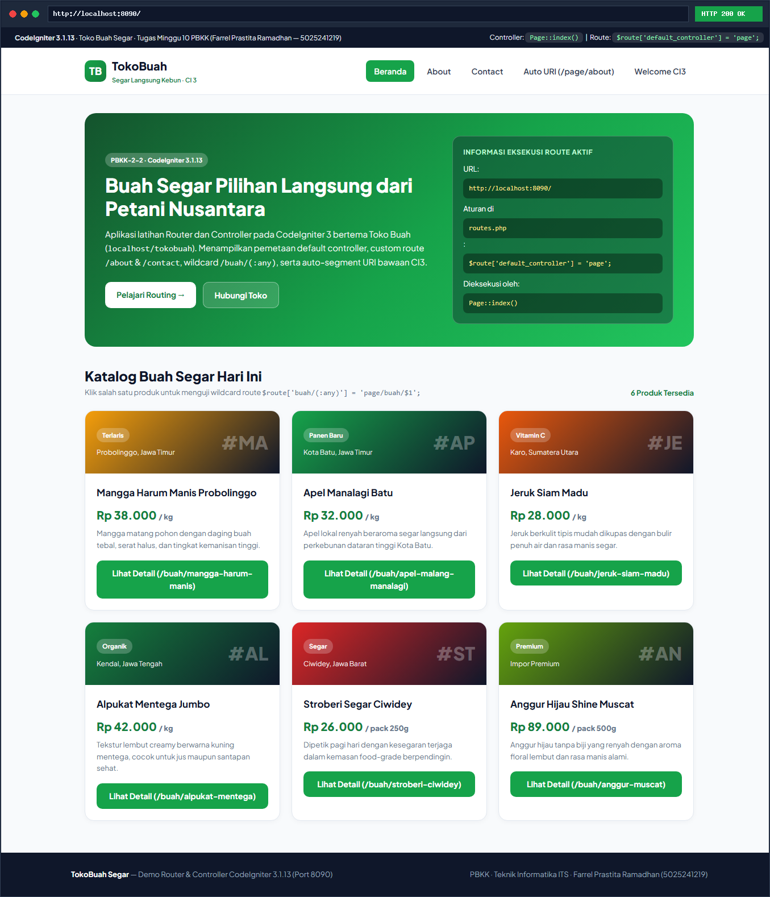

#### Halaman About (`/about`) dan Bukti Auto Segment URI (`/page/about`)
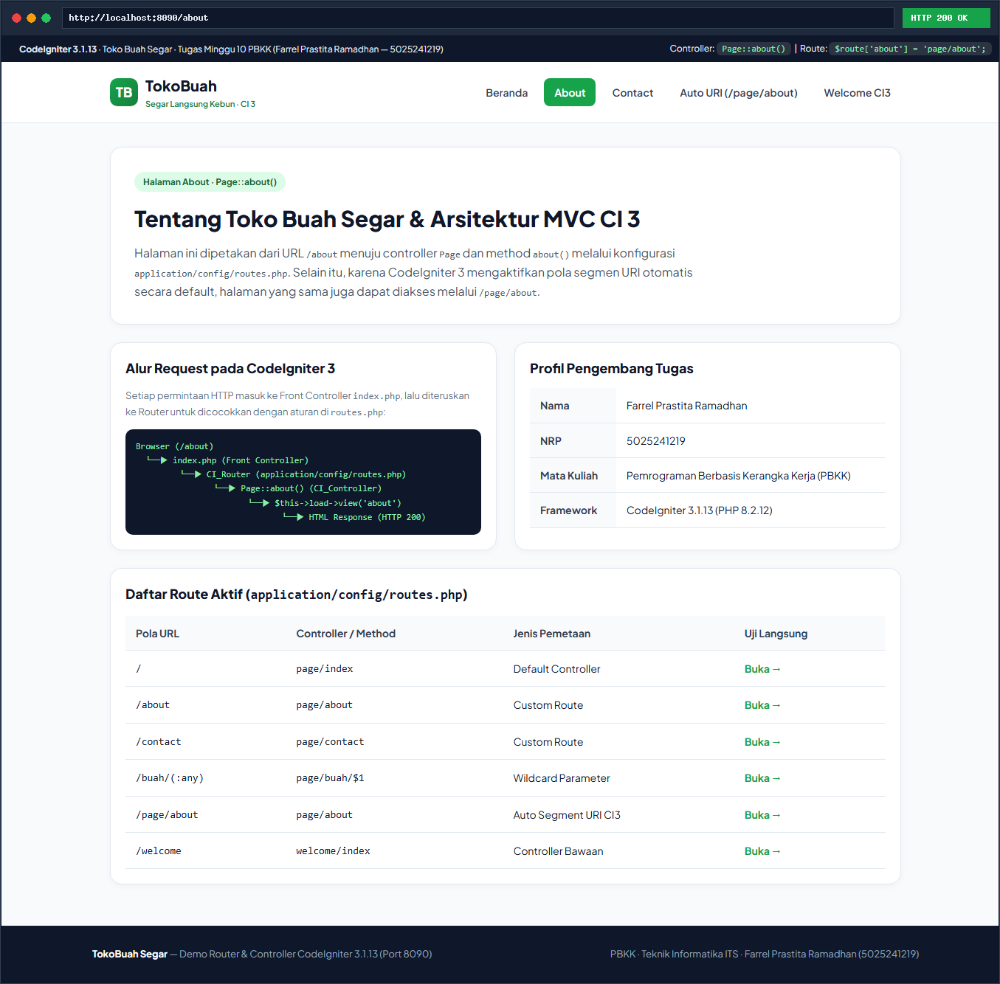
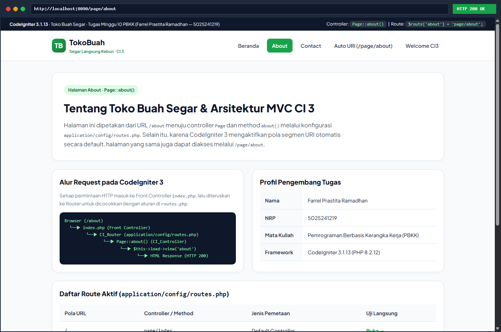

#### Halaman Contact Setelah Pengiriman Form (`POST /contact`)
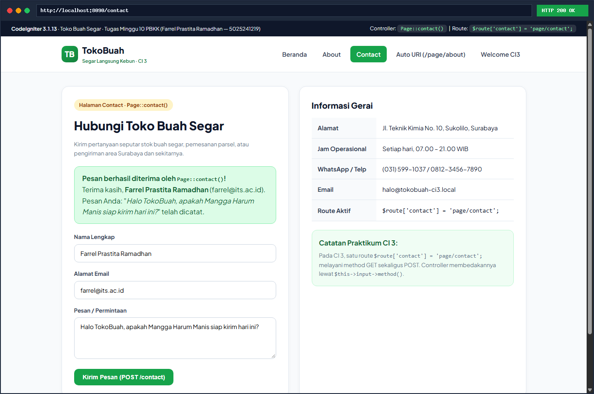

#### Wildcard Parameter (`/buah/mangga-harum-manis`) dan Custom 404 Override
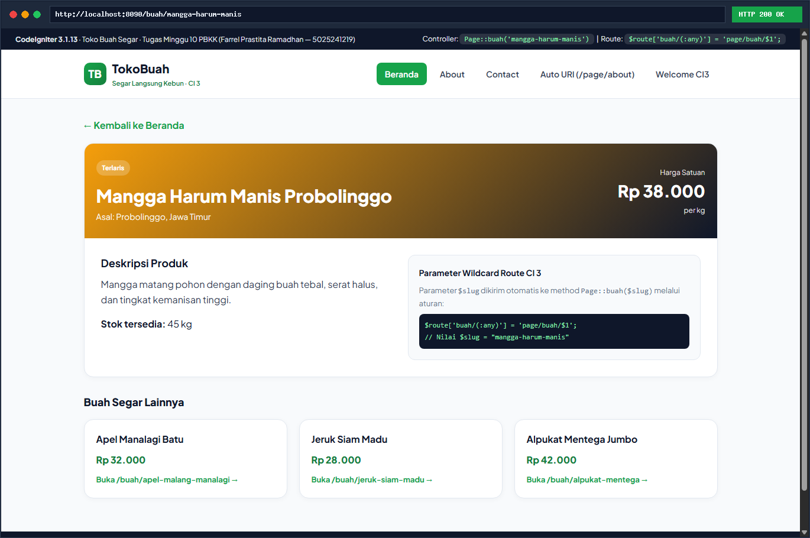
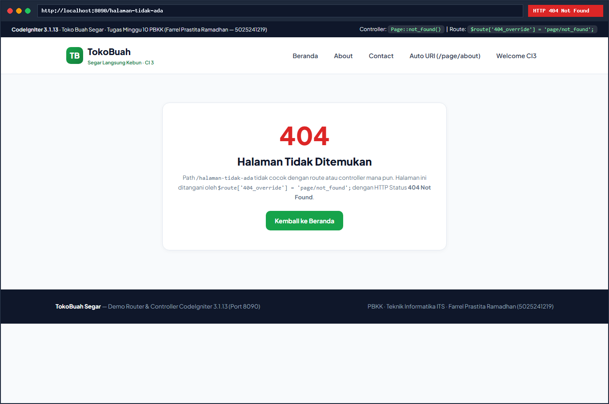

---

## 4. Implementasi Proyek 2 — CodeIgniter 4 (`CI4/`)

### 4.1 Konfigurasi Route (`CI4/app/Config/Routes.php`)

```php
$routes->setAutoRoute(false);

$routes->get('/', 'Home::index', ['as' => 'home']);
$routes->get('about', 'Page::about', ['as' => 'page.about']);
$routes->get('contact', 'Page::contact', ['as' => 'page.contact']);
$routes->post('contact', 'Page::sendContact', ['as' => 'page.contact.send']);
$routes->get('faqs', 'Page::faqs', ['as' => 'page.faqs']);
$routes->get('tos', 'Page::tos', ['as' => 'page.tos']);

$routes->group('katalog', static function ($routes) {
    $routes->get('/', 'CatalogController::index', ['as' => 'catalog.index']);
    $routes->get('(:segment)', 'CatalogController::category/$1', ['as' => 'catalog.category']);
    $routes->get('produk/(:num)/(:segment)', 'CatalogController::detail/$1/$2', ['as' => 'catalog.detail']);
});

$routes->group('info', static function ($routes) {
    $routes->get('pengiriman', 'InfoController::shipping', ['as' => 'info.shipping']);
    $routes->get('garansi', 'InfoController::warranty', ['as' => 'info.warranty']);
});
```

### 4.2 Inspeksi Route CLI (`php spark routes`)
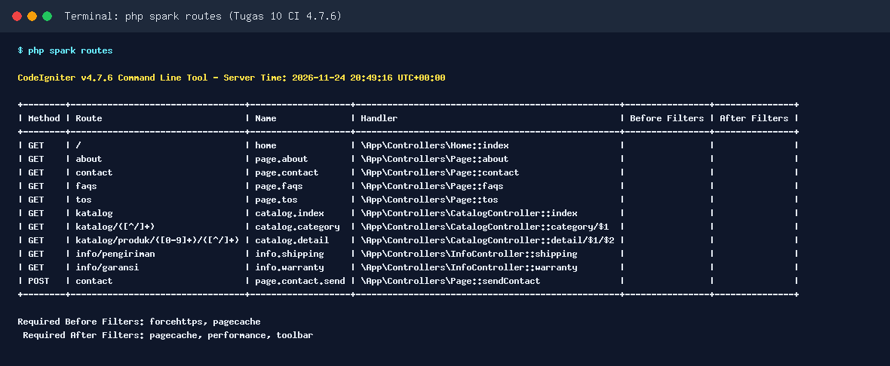

### 4.3 Hasil Pengujian & Screenshot CodeIgniter 4

| No | Route / Endpoint | Named Route / Fitur | Status HTTP | Bukti Screenshot |
| :-: | :--- | :--- | :---: | :--- |
| 1 | `/` | `home` · Landing Page ShopEase Fresh + View Layout | `200 OK` | `07-ci4-beranda.png` |
| 2 | `/about` | `page.about` · `Page::about()` | `200 OK` | `08-ci4-about.png` |
| 3 | `/contact` (POST) | `page.contact.send` · Validasi Server-Side + CSRF | `200 OK` | `09-ci4-contact-submitted.png` |
| 4 | `/faqs` | `page.faqs` · `Page::faqs()` | `200 OK` | `10-ci4-faqs.png` |
| 5 | `/katalog/buah-lokal` | `catalog.category` · Route Group + `(:segment)` | `200 OK` | `11-ci4-katalog-group.png` |
| 6 | `/katalog/produk/101/mangga-harum-manis` | `catalog.detail` · Multi-Placeholder `(:num)/(:segment)` | `200 OK` | `12-ci4-detail-placeholder.png` |
| 7 | `/info/pengiriman` | `info.shipping` · Route Group `/info/*` | `200 OK` | `13-ci4-info-group.png` |
| 8 | `/page/about` | Pembuktian `$routes->setAutoRoute(false)` → Custom 404 | `404 Not Found` | `14-ci4-autoroute-off-404.png` |

#### Landing Page ShopEase Fresh CI 4 (`/`)
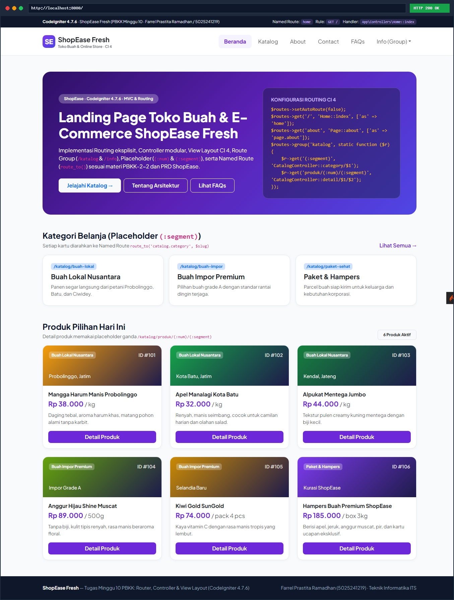

#### Halaman About (`/about`) dan Contact Setelah Submit CSRF (`POST /contact`)
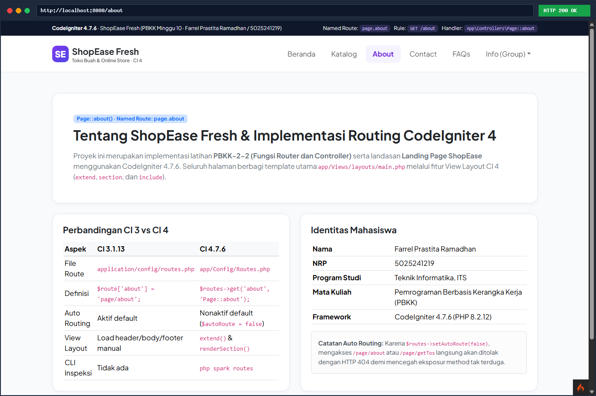
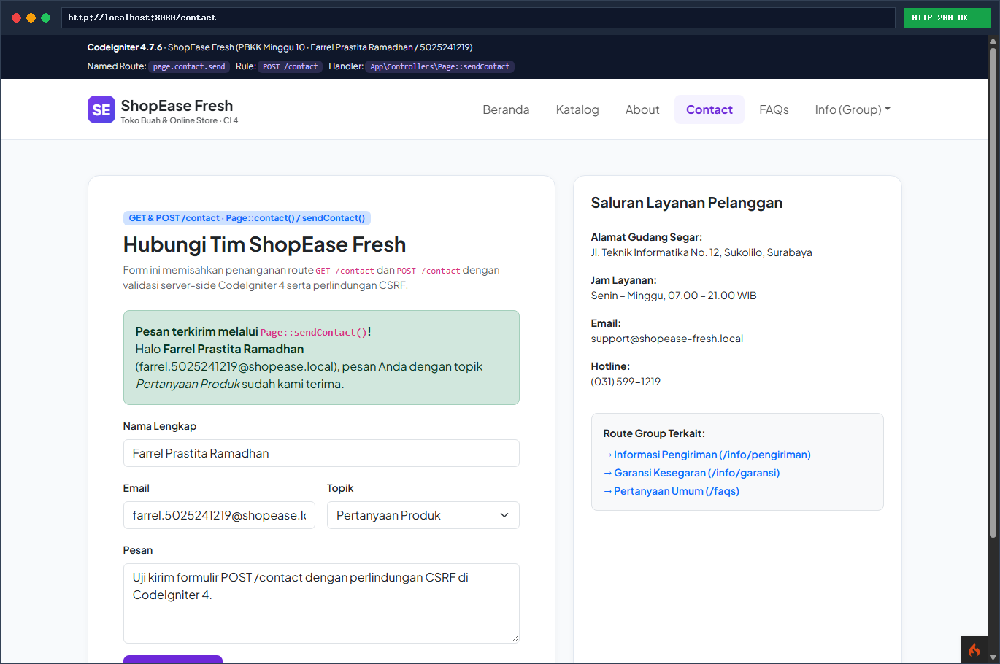

#### Halaman FAQs (`/faqs`) dan Route Group Katalog dengan Placeholder `(:segment)`
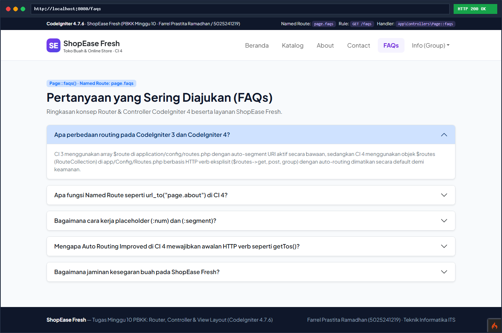
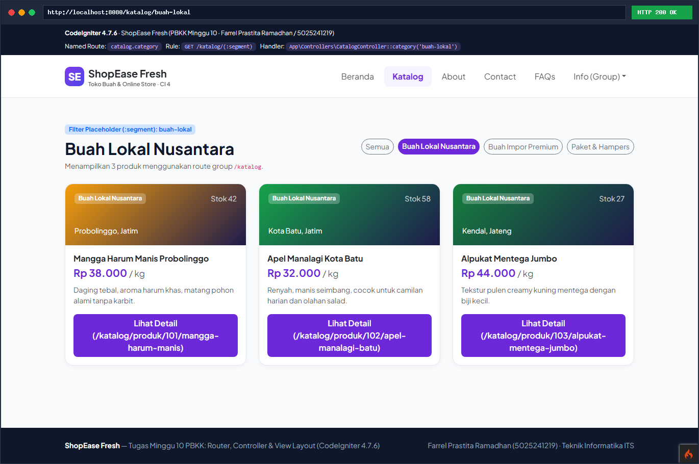

#### Detail Produk Multi-Placeholder `(:num)/(:segment)` dan Route Group `/info/pengiriman`
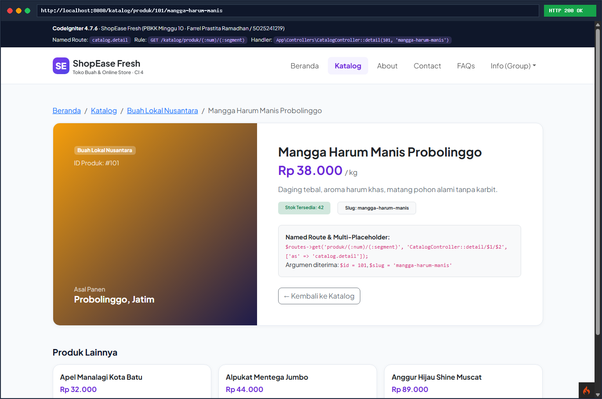
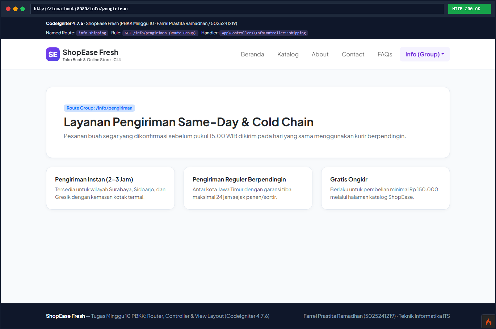

#### Bukti Keamanan Auto Routing Nonaktif (`/page/about` → HTTP 404)
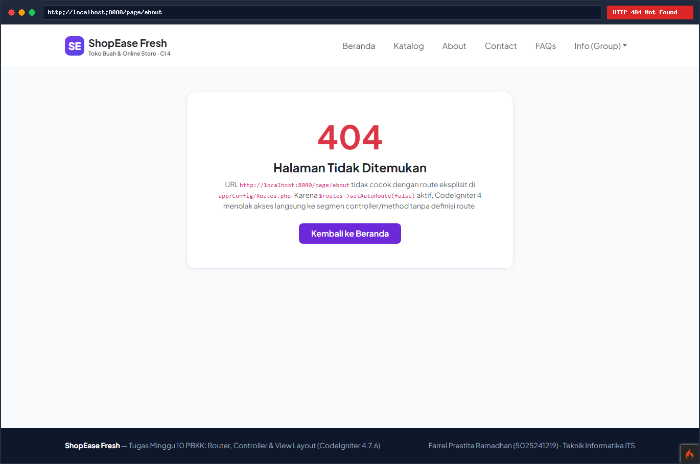

---

## 5. Cara Menjalankan Lokal

### CodeIgniter 3 (Port 8090)
```powershell
cd CI3
php -S 127.0.0.1:8090 router.php
```

### CodeIgniter 4 (Port 8080)
```powershell
cd CI4
composer install
cp .env.example .env
php spark serve --port 8080
```
*(Jika memakai PHP XAMPP dengan ekstensi belum aktif di `php.ini`, dapat langsung menjalankan `.\serve.bat`.)*

